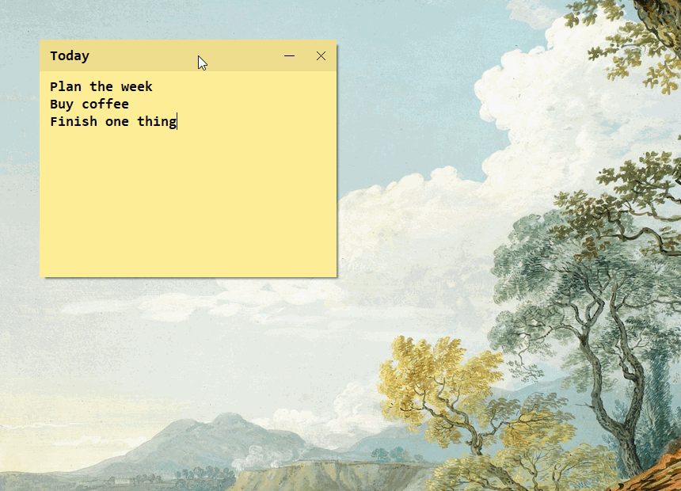

#  PicoSlip

Tiny sticky notes for Windows. **Pure C, no dependencies.**

**[Download installer](https://github.com/GarauGarau/picoslip/releases/latest/download/PicoSlip-Setup-x64.exe)** · [Portable ZIP](https://github.com/GarauGarau/picoslip/releases/latest/download/PicoSlip-portable-x64.zip)

Windows 10/11, x64. Installs for your account without administrator rights.


## Use

- **Ctrl + Alt + +** creates a note. The numpad `+` works too.
- Drag the top bar to move it; double-click it to edit the title. **−** collapses it; **□** expands it; **×** closes it.
- Drag edges or corners to resize; **Ctrl + mouse wheel** scales the current proportions.
- **Ctrl + B/I/U** toggles bold/italic/underline; **Ctrl + Shift + X** toggles strikethrough.
- `*` + **Shift + Enter** starts checkboxes. **Enter** adds items; **Backspace** on an empty item ends the list. Click a box to check it and strike its text.
- First line: `#Title` + **Enter** makes a title. **Shift + Enter** keeps it as text.
- Right-click the top bar for options:

| Option | What it does |
|---|---|
| Open notes archive | Opens the saved TXT files |
| Browse notes | Monospaced post-it mosaic by year/month/day; click to reopen, Ctrl/Shift-select and right-click to delete |
| Opacity | 100%, 90%, 80%, 70% or 60% |
| Edit title | Change it, or leave it empty to remove it |
| Note size | Small, medium, large, extra large or square |
| New note palette | Pastel, black and white, or yellow only |




Notes stay on top, with a subtle shadow. Text never scrolls; a smaller size is refused if the text would not fit. The tray icon creates notes; right-click it to exit.

## Your notes

Text saves automatically as UTF-8 in `%LOCALAPPDATA%\PicoSlip\notes`:

```text
note-2026-11-04_08-35-27-123-000.txt
```

Names sort by local creation date and time. Empty notes are not saved. Closing a nonempty note keeps its file. Open notes return on restart. Uninstalling keeps the archive.

The portable ZIP keeps `notes` beside the EXE. Back up the whole folder, including `notes.ini` and the RTF formatting companions.

## Resources

About **208 KiB** for the app, **358 KiB** for the installer. With 1–10 default notes: **~2.5–4 MiB private RAM**, **17–25 MiB working set**, **0–0.5% of one CPU core at idle** (10-second samples, Windows 11 x64).

## Build

MSVC + Windows SDK: `build.cmd` builds the app and installer; `build.cmd test` runs the tests (`--interactive` adds real keyboard/mouse input). Release binaries are unsigned.

[Screenshot background](https://images.unsplash.com/photo-1578926375605-eaf7559b1458)
