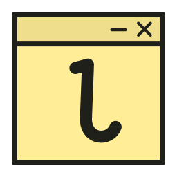
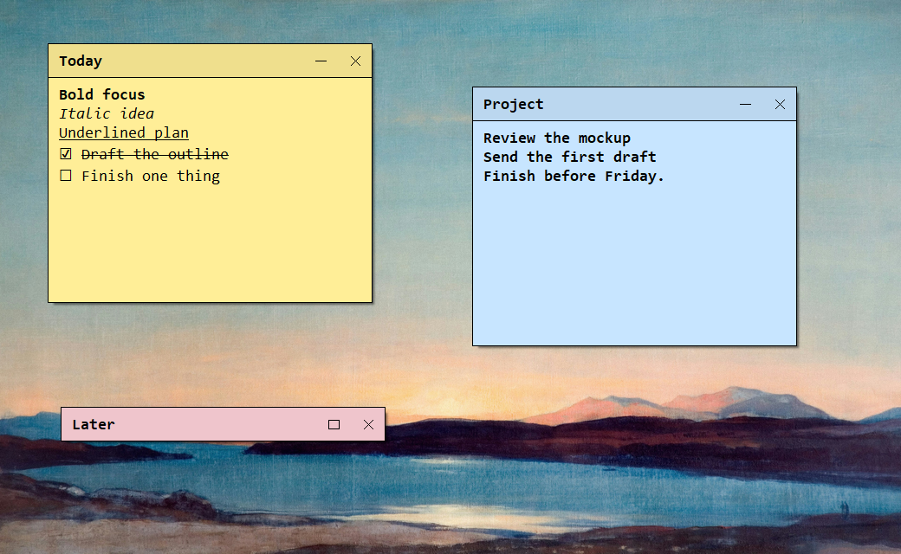
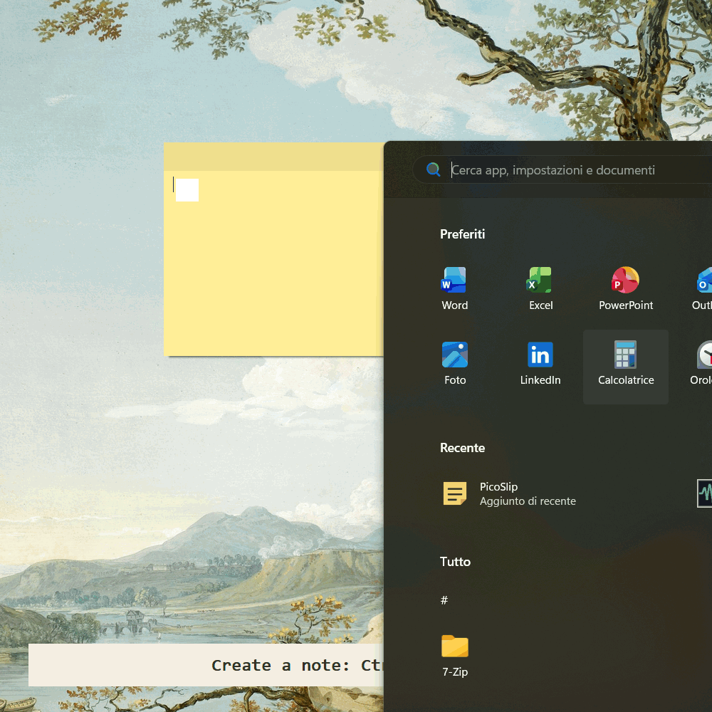
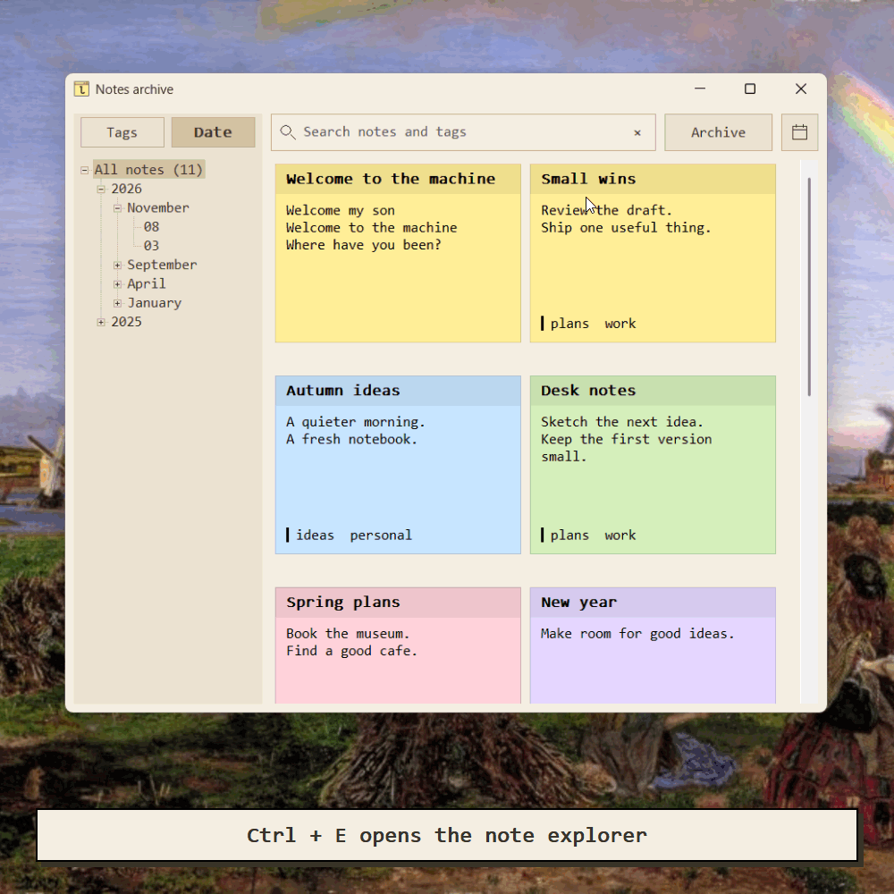
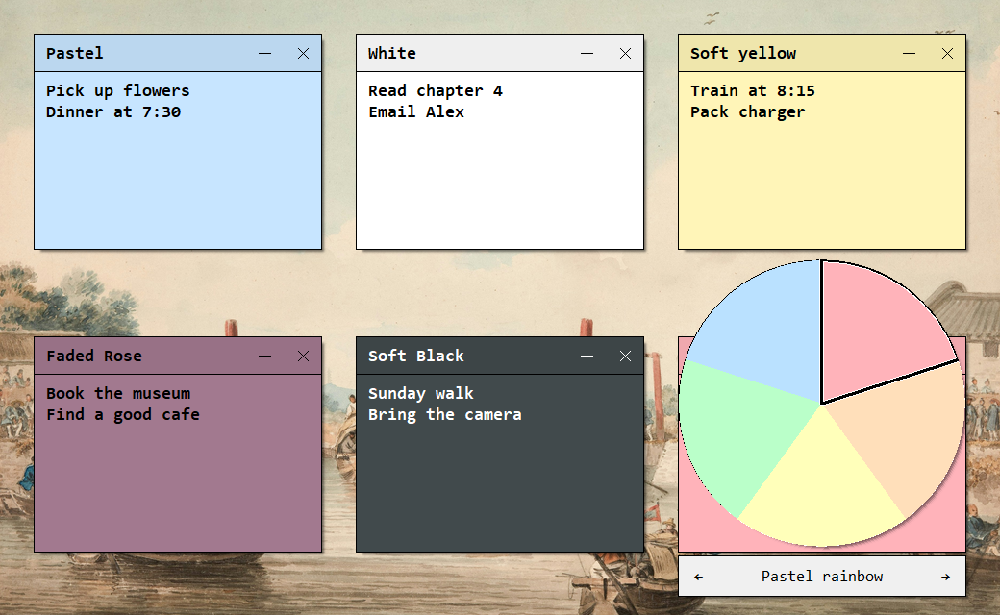

#  Jotila

Jotila is a small Windows app for taking quick notes on your desktop. Notes are saved and archived automatically, so you can find, reopen and update them later. Sticky notes, on silicon. :)

**[Windows builds](https://github.com/GarauGarau/Jotila/actions/workflows/windows.yml)** · [Releases](https://github.com/GarauGarau/Jotila/releases)

The latest successful build includes the installer and portable ZIP in the **Jotila-windows-x64** artifact.

Windows 10/11, x64. No administrator rights or extra dependencies required.



<sub>Background: Sundown, Loch Rannoch</sub>

## Everyday use

- **Ctrl + Alt + +** creates a note; the numpad `+` works too.
- Drag the title bar to move a note, double-click to rename it, or use **− / □** to collapse and expand it. **×** closes the note and keeps it in the archive.
- Drag an edge or corner to resize, or use **Ctrl + mouse wheel**. Notes stay on top and prevent resizing below what the text needs.
- Right-click the title bar for the archive, tags, opacity, sizes and the original three palettes for new notes.
- Right-click inside a note for the color wheel. **← / →** browse palettes; click a wedge to apply and close. **Esc** cancels. New notes draw from that palette for the rest of the session; **★** saves it for future starts.
- Select text before right-clicking to color just that selection. Custom text colors stay intact when you change the background.

| Action | Shortcut |
|---|---|
| Bold, italic, underline | **Ctrl + B / I / U** |
| Strikethrough | **Ctrl + Shift + X** |
| Start a checklist | Type `*`, then **Shift + Enter** |
| Add or finish checklist items | **Enter** adds an item; **Backspace** on an empty item ends the list |
| Turn the first line into a title | Type `#Title`, then **Enter** |
| Edit tags | **Ctrl + T**; separate tags with `;` |
| Search all notes | **Ctrl + Shift + F** |

Click a checkbox to mark a task complete. In the archive, search by text or tags, filter by date, and click a note to reopen it. Use `#work` for an exact tag, `"release plan"` for a phrase, or `-#` for untagged notes. **Ctrl + F** focuses search; **F5** refreshes external edits.

Minimizing the archive sends it to the notification area. Double-click the tray icon to restore it; a single click creates a note.

<table>
  <tr>
    <td width="50%" align="center" valign="top">
      <br>
      <sub>Background: February Fill Dyke</sub>
    </td>
    <td width="50%" align="center" valign="top">
      <br>
      <sub>Background: Walton-on-the-Naze</sub>
    </td>
  </tr>
</table>



<sub>Background: Stern View of Boat Going Down a Glacis, Nr Ning P-0</sub>

## Your notes

Notes save automatically as UTF-8 text files in `%LOCALAPPDATA%\Jotila\notes`, or in `notes` beside the portable EXE. Empty notes are not saved. Open notes return on restart, and uninstalling leaves your archive intact.

Upgrading from an earlier release keeps your existing archive in its original location.

Use **Archive** in the archive window to move your notes or open another archive. Back up the whole folder, including `notes.ini` and the RTF files that preserve formatting.

## Development

Written in **C17** using the native Windows UI and rich text editor. Build with MSVC and the Windows SDK:

```bat
build.cmd                 rem Build the app and installer
build.cmd test            rem Run integration tests
build.cmd test-checked    rem Run tests with runtime checks
build.cmd analyze         rem Run static analysis
```

Sources live in `src/`, tests in `tests/`, and supporting tools in `tools/`. Generated files go to `build/` and `dist/`. Release binaries are unsigned.

With ImageMagick installed, `tools/capture.ps1` regenerates the screenshots and demos using local artwork; `-OverviewOnly` refreshes just the first screenshot. Pass `-BackgroundRoot` to choose the artwork folder. Backgrounds are from the Birmingham Museums Trust collection.
